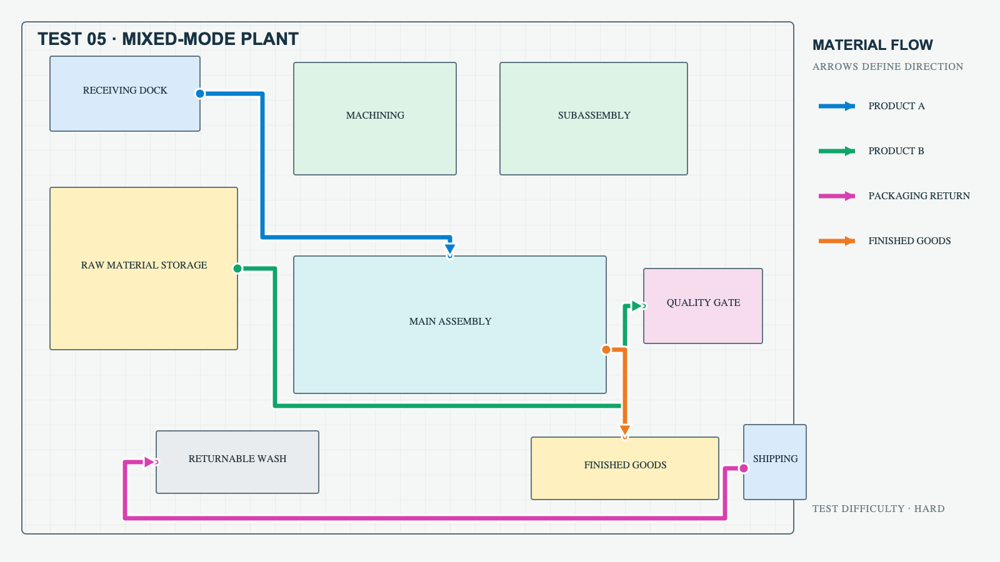

# Plant Flow HTML Builder

**Turn a static factory floor-plan image into an interactive, validated material-flow map.**

Plant layouts usually live as PowerPoint slides with hand-drawn arrows. They are hard to update and impossible to animate or filter. This project defines a repeatable, **AI-agent-assisted workflow** with three parts:

1. **Extract** zones and flow routes from a layout image into a JSON *ground-truth manifest*.
2. **Build** a self-contained HTML/SVG page from a template. It has animated flow dots, per-flow filters, independent speed controls, label toggles, and a responsive layout.
3. **Validate** the generated page against the manifest with an automated checker covering zones, routes, direction, colors and controls.

I built this during my 2026 Global Operations Excellence internship to visualize current-state vs. future-state material flows in a manufacturing hall. **This public version uses only fictional test plants.** No real factory layout is included.

**Stack:** Python (validation and test-case generation) · vanilla HTML / SVG / JavaScript · packaged as an AI agent skill (`SKILL.md`)

---

## Demo
Open [`demo/mixed-mode-plant.html`](demo/mixed-mode-plant.html) in a browser. It is a fictional 9-zone plant with 4 product/packaging flows that you can filter, pause and speed up independently.



## How it works
```
layout image ──► ground-truth manifest (JSON) ──► interactive HTML ──► validator
                 zones: id, label, bbox, color      native SVG zones     zone ids & bboxes
                 flows: ordered waypoints           animated routes      route source → destination
                 evidence + confidence              per-flow speed       one speed input per flow
```
Design rules ([`SKILL.md`](SKILL.md), [`references/specification.md`](references/specification.md)):
- Geometry is data. Zone positions, sizes and adjacency are preserved, never rearranged for aesthetics.
- Every route is encoded from source to destination, and the moving dots must advance in path order.
- Routes go through aisles, and parallel flows are offset into separate lanes.
- An uncertain direction (no arrowhead or annotation) is flagged rather than guessed.

## Validation
[`scripts/validate_flow_html.py`](scripts/validate_flow_html.py) parses the generated HTML and compares it with the manifest:
- every zone is present (`data-zone-id`) and its color matches;
- every route is present (`data-route-id`), with correct `data-source` and `data-destination` and ordered waypoints;
- every flow has its own speed input.

```bash
python scripts/validate_flow_html.py demo/mixed-mode-plant.html \
       --manifest demo/mixed-mode-plant.ground-truth.json
# → "errors": [], "passed": true
```

## Test suite
[`test-cases/`](test-cases/) holds 5 synthetic layouts of increasing difficulty: linear line, three-lane hall, branch & merge, asymmetric retrofit, and mixed-mode plant. Each comes with an SVG, a PNG and a ground-truth manifest, and they are browsable via `test-cases/test-suite.html`. Regenerate them with:
```bash
python scripts/generate_test_cases.py test-cases/
```

## Repository structure
```
├── SKILL.md                         # agent workflow and non-negotiable rules
├── references/specification.md      # manifest schema, extraction and scoring rules
├── assets/                          # reusable HTML template + its manifest
├── scripts/
│   ├── generate_test_cases.py       # synthetic plant layouts with ground truth
│   └── validate_flow_html.py        # HTML ↔ manifest checker
├── test-cases/                      # 5 fictional plants (SVG, PNG, manifest)
└── demo/                            # finished interactive example
```
